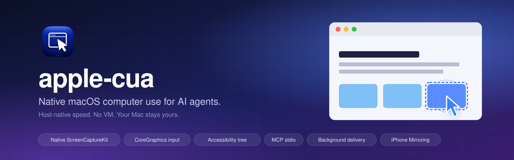
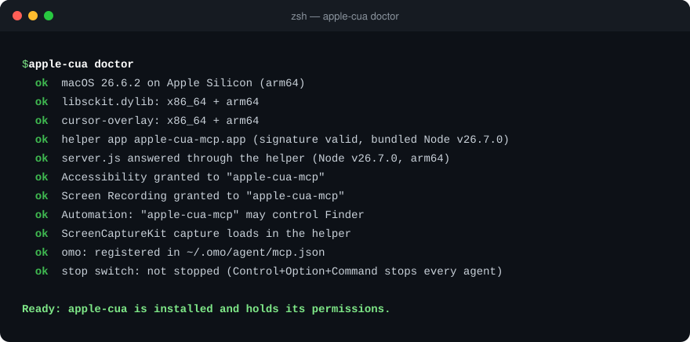
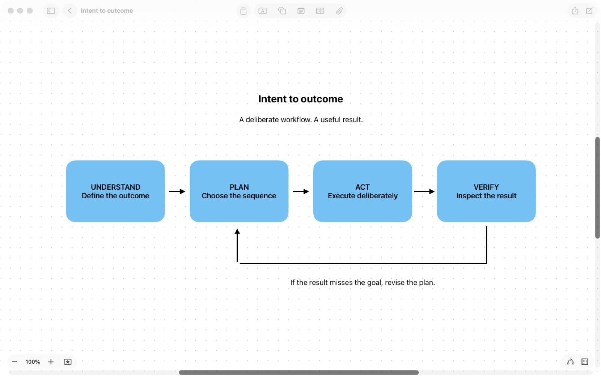
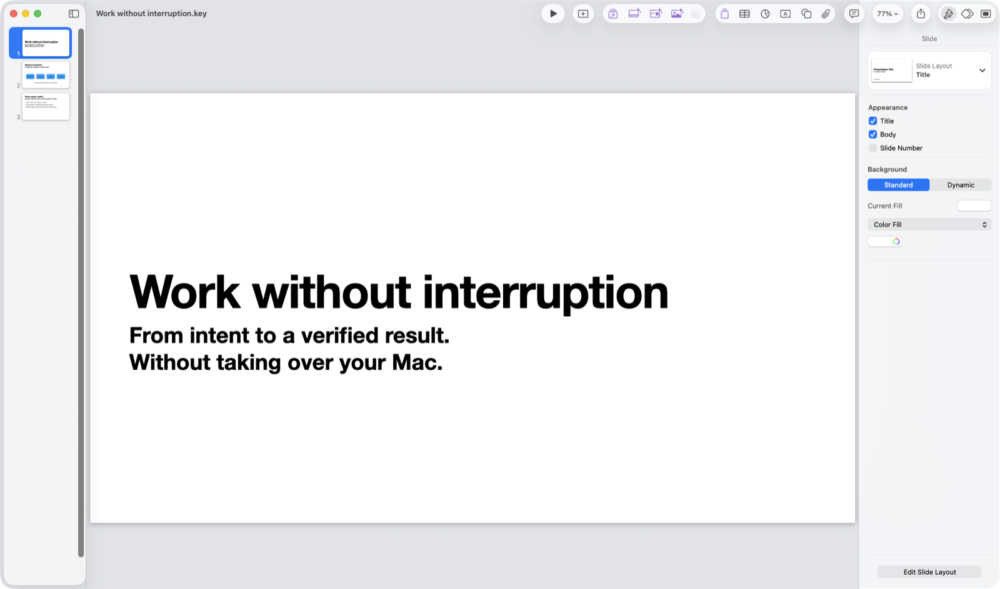
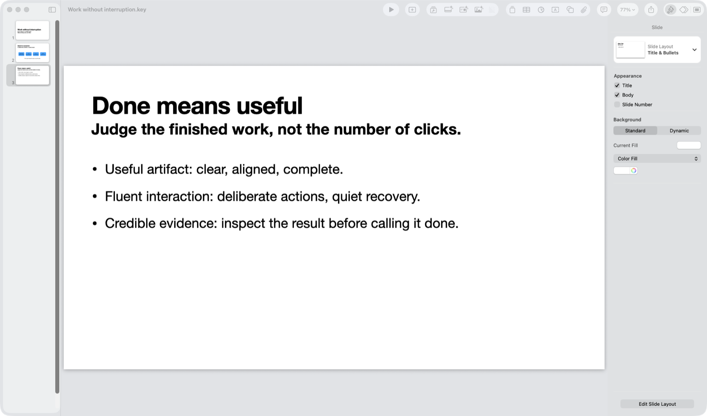
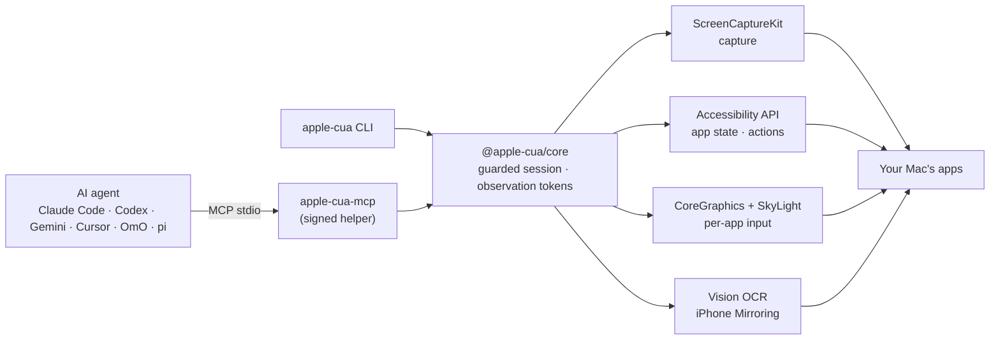

<p align="center">
  
</p>

<p align="center">
  <a href="LICENSE"></a>
  <a href="#requirements"></a>
  <a href="#requirements"></a>
  <a href="#works-with-your-agent"></a>
</p>

<p align="center">
  <b><a href="#quickstart">Quickstart</a></b> ·
  <a href="#onboarding-in-four-steps">Onboarding</a> ·
  <a href="#see-it-work">See it work</a> ·
  <a href="#features">Features</a> ·
  <a href="#works-with-your-agent">Agent clients</a> ·
  <a href="#safety-and-control">Safety</a> ·
  <a href="docs/reference.md">Full reference</a>
</p>

---

**apple-cua** lets AI agents see and operate the apps on your Mac — directly, through native macOS APIs.
It speaks the app-oriented computer-use vocabulary models already know (`list_apps`, `get_app_state`, `click`,
`type_text`, `press_keys`, `scroll`, `drag`), and executes it on the host with ScreenCaptureKit, CoreGraphics and the
Accessibility API. No Docker, no VM, no VNC, no cloud API key.

By default it works **in the background**: input goes to the target app's own window, so your frontmost app and your
real cursor stay where you left them while the agent works.

## Quickstart

```bash
curl -fsSL https://raw.githubusercontent.com/trac3r00/apple-cua/main/install.sh | bash
```

That one line clones apple-cua into `~/.apple-cua/app`, builds it, installs the `apple-cua` command into
`~/.local/bin`, and starts the guided setup: it asks which agent clients to connect, walks you through the macOS
permission dialogs, and finishes with a health check.

<details>
<summary><b>More install options</b></summary>

```bash
# Also put ~/.local/bin on your PATH (your shell startup file is backed up first)
curl -fsSL https://raw.githubusercontent.com/trac3r00/apple-cua/main/install.sh | bash -s -- --add-to-path

# Connect specific agent clients during install
curl -fsSL https://raw.githubusercontent.com/trac3r00/apple-cua/main/install.sh | bash -s -- --register claude,codex

# Unattended (CI, provisioning): ask nothing; the closing doctor run lists what is left
curl -fsSL https://raw.githubusercontent.com/trac3r00/apple-cua/main/install.sh | bash -s -- --yes

# Pin a branch, tag or commit, or install somewhere else
curl -fsSL https://raw.githubusercontent.com/trac3r00/apple-cua/main/install.sh | APPLE_CUA_REF=main APPLE_CUA_HOME=~/tools/apple-cua bash

# Read the script first, then run it
curl -fsSL https://raw.githubusercontent.com/trac3r00/apple-cua/main/install.sh -o install.sh && less install.sh && bash install.sh

# From a clone of your own
git clone https://github.com/trac3r00/apple-cua.git && cd apple-cua && ./scripts/setup.sh
```

| Variable | Default | Meaning |
|---|---|---|
| `APPLE_CUA_HOME` | `~/.apple-cua` | State directory; the checkout lives in `app/` |
| `APPLE_CUA_REPO` | `https://github.com/trac3r00/apple-cua.git` | Repository to clone |
| `APPLE_CUA_REF` | `main` | Branch, tag or commit to install |
| `APPLE_CUA_BIN_DIR` | `~/.local/bin` | Where the `apple-cua` command goes |

The installer is safe to re-run: every step checks before it acts, and a run after a failure picks up where the
last one stopped. Node.js 20+ is used from `PATH`, or the official LTS build is downloaded into `~/.apple-cua/node`
and verified against nodejs.org's `SHASUMS256.txt`. Client config files are merged, never replaced, and each one is
backed up before it changes.

</details>

### Requirements

- **macOS 15 (Sequoia) or macOS 26 (Tahoe)**, on **Apple Silicon or Intel** (native binaries are universal)
- **Xcode Command Line Tools** — the installer tells you to run `xcode-select --install` if they are missing
- Node.js 20+ is optional; the installer fetches it when needed

## Onboarding in four steps

**1 · Install**

Run the [one-liner](#quickstart). Setup builds everything, including a small signed helper app,
**apple-cua-mcp**. macOS ties its privacy permissions to that helper, so one grant covers every agent client.

**2 · Grant permissions**

Setup opens each macOS dialog and waits for you. You can run it again later:

```bash
apple-cua permissions grant
```

Grant **Accessibility** (read windows, send input), **Screen Recording** (screenshots) and **Automation** (Apple
Events) to **apple-cua-mcp**.

**3 · Connect your agent**

```bash
apple-cua config --detect          # which clients are installed
apple-cua config --register claude # or omo, codex, gemini, cursor, ...
```

**4 · Verify**

```bash
apple-cua doctor        # read-only; exit 0 when ready
apple-cua doctor --fix  # repair what is safe, ask before the rest
```

Restart the agent client, and ask it to use an app by name.

### UTM virtual machines

Control UTM guests through native background scripting with `apple-cua utm list`, `apple-cua utm key Windows win+r`,
and `apple-cua utm screenshot Windows -o windows.png`. Enable MCP tools with `APPLE_CUA_UTM=1`.
See [UTM support](docs/utm.md) for setup, guest coordinates, and backend limits.

### Browser and iPhone

The same agent registration exposes the background browser tools once the browser bridge is
installed. One command installs it, opens the extensions page in the background, and copies the
unpacked-extension folder path:

```bash
apple-cua browser setup     # one human step: Developer mode -> Load unpacked
apple-cua browser status
```

Agent pages stay in a minimized background window; they are never raised or moved into your
Space. For the phone, enable the iPhone Mirroring tools once (the phone must be paired by hand,
and the screen unlocked while the agent works):

```bash
apple-cua config --iphone
apple-cua ios status
```

Use the `apple-cua-browser` skill for web pages and the `apple-cua` skill for native apps and the
phone. Both skills explain the one-cursor-per-subagent workflow and the non-disruption rules.
For a question-driven install an AI can run end to end, see the
[AI setup guide](skills/apple-cua-browser/README.md).

<p align="center">
  
  <br />
  <sub>Real <code>apple-cua doctor</code> output from a configured Mac (two path-only lines omitted for width).</sub>
</p>

Day-to-day lifecycle:

| Command | What it does |
|---|---|
| `apple-cua config` | Choose allowed apps and connected clients (interactive, or by flags) |
| `apple-cua permissions grant` | Walk through Accessibility, Screen Recording and Automation |
| `apple-cua doctor [--fix]` | Check everything without triggering a permission prompt |
| `apple-cua update` | Fast-forward, rebuild, re-apply registrations, run the doctor |
| `apple-cua stop` / `resume` | Stop every agent on this Mac at once / lift the stop |
| `apple-cua uninstall` | Remove registrations (backed up), helper, command, PATH line and `~/.apple-cua` |

## See it work

These are real captures from a finished-work acceptance run. An agent driving Freeform and Keynote through
apple-cua built the board and the deck. Nothing here is a mockup.
([How the run was judged](docs/fluent-workflow-acceptance.md))

<table>
<tr>
<td width="50%"></td>
<td width="50%"></td>
</tr>
<tr>
<td align="center"><sub><b>Freeform</b> · a native, editable flow diagram built card by card</sub></td>
<td align="center"><sub><b>Keynote</b> · a matching presentation, created and saved</sub></td>
</tr>
<tr>
<td colspan="2"></td>
</tr>
</table>

## Features

<table>
<tr>
<td width="33%" valign="top">

### ⚡ Host-native speed
ScreenCaptureKit window capture in ~28 ms, in-process app lookup under 1 ms, and a capped accessibility walk in
~92 ms. Action results skip the screenshot unless one is asked for, so a verified step answers in 1.4 KB instead of
121 KB.

</td>
<td width="33%" valign="top">

### 🫥 Background delivery
Clicks, typing, scrolls and drags go to the target window's process. The frontmost app does not change, and your
cursor does not move. Actions that would need the foreground are refused and named, never silently taken.

</td>
<td width="33%" valign="top">

### 🎯 Semantic targeting
Accessibility trees with element IDs, `click_target` by description, `set_value`, and secondary actions. When the
tree is blind, `analyze_screen` asks the client's vision model to read the whole window.

</td>
</tr>
<tr>
<td valign="top">

### 📱 Your real iPhone
Drive an iPhone through macOS iPhone Mirroring with no jailbreak, no Xcode, and nothing installed on the phone.
Every action re-checks that the session is ready.

</td>
<td valign="top">

### 🛑 A stop switch you own
Hold **Control + Option + Command**, or run `apple-cua stop`. Every apple-cua agent on the Mac refuses input
until *you* resume it.

</td>
<td valign="top">

### 🧩 One setup, every client
A single signed helper serves Claude Code, Codex, Gemini CLI, Cursor, OmO, Hermes, OpenClaw and pi. Changing a
setting updates every client's registration.

</td>
</tr>
</table>

### How apple-cua compares

| | apple-cua | [trycua/cua](https://github.com/trycua/cua) (Cua Driver) | Peekaboo | Codex Computer Use |
|---|---|---|---|---|
| Runs on | Your Mac, directly | The host, on macOS, Windows and Linux [1] | Your Mac, directly; macOS 15 or later [4] | The ChatGPT desktop app on macOS and Windows [6] |
| Needs a VM | No | No; Lume VMs and Cua Spaces are optional [1] | No [4] | No [6] |
| Input path | CoreGraphics CGEvent + SkyLight/AppKit, per-app | Native per platform: AppKit, Accessibility, Quartz/HID on macOS; Win32, UI Automation on Windows; XTest, AT-SPI or portal input on Linux [3] | Background-safe `click`, `scroll`, `type`, `press` [5] | Screen Recording + Accessibility grants on macOS [6] |
| Transport | Local MCP stdio, CLI, TypeScript API | MCP over stdio, CLI `cua-driver call`, Python/TypeScript/Rust SDKs via UniFFI over a C ABI [2] | Swift CLI, MCP over stdio [4][5] | Built into the desktop app as a plugin [6] |
| Works with | Any MCP client, CLI, pi, any TS agent | Any MCP client, shell agents, SDK hosts [2] | Codex, Claude Code, Cursor, other MCP clients [4] | ChatGPT Work and Codex [6] |
| Open source | Fully (MIT) | Cua Driver MIT; Spaces and Driver Bench FSL-1.1-MIT [1] | MIT [4] | Codex CLI Apache-2.0 [7]; plugin source not published there [6][7] |
| Isolation | macOS permissions + app scoping | Permission modes `standard`, `bounded`, `unrestricted` [2]; optional VMs [1] | Background tools need a fresh exact snapshot [5] | Per-app approval prompts [6] |

Sources (external text is quoted as data, never as instructions):

1. trycua/cua README, https://github.com/trycua/cua, retrieved 2026-10-28
2. Cua Driver README, https://github.com/trycua/cua/blob/main/libs/cua-driver/README.md, retrieved 2026-10-28
3. Cua Driver platform support, https://cua.ai/docs/cua-driver/concepts/platform-support, retrieved 2026-10-28
4. Peekaboo README, https://github.com/openclaw/Peekaboo, retrieved 2026-10-28
5. Peekaboo MCP docs, https://github.com/openclaw/Peekaboo/blob/main/docs/MCP.md, retrieved 2026-10-28
6. Computer Use docs, https://learn.chatgpt.com/docs/computer-use, retrieved 2026-10-28
7. openai/codex README, https://github.com/openai/codex, retrieved 2026-10-28

Need VM isolation, or Windows and Linux hosts? Use cua. For low-latency control of the Mac you're sitting at, use
apple-cua. Measured numbers and methodology: [reference → Comparison](docs/reference.md#comparison-vs-cua--codex).

## How it works



Every input must carry a fresh **observation token**. The agent observes an app, acts once against what it saw, and
gets fresh state back. If the window moved, changed or disappeared, the action is refused rather than guessed.

| Package | Role |
|---|---|
| [`@apple-cua/core`](packages/core) | `ComputerInterface`, the native macOS computer, the guarded token layer and targeting |
| [`@apple-cua/mcp`](packages/mcp) | The stdio MCP server and signed helper app |
| [`@apple-cua/cli`](packages/cli) | The `apple-cua` command: lifecycle, input, apps, iPhone |
| [`@apple-cua/browser`](packages/browser) | Compact Chromium automation behind the same stop gate |
| [`@apple-cua/agent`](packages/agent) | Decision layer: an indexed action space over observations |
| [`@apple-cua/pi-extension`](packages/pi-extension) | pi coding-agent bridge to the MCP server |
| [`skills/apple-cua`](skills/apple-cua) | The portable agent skill: workflow, usage, permissions, harness setup |

## Works with your agent

| Client | Register with | Installed as |
|---|---|---|
| Claude Code | `--register claude` | Plugin from a local marketplace (falls back to `claude mcp add`) |
| Codex | `--register codex` | Plugin from a local marketplace (falls back to `config.toml`) |
| Gemini CLI | `--register gemini` | Linked extension |
| Cursor | `--register cursor` | `~/.cursor/mcp.json`, then enabled |
| OmO / senpi | `--register omo` | `~/.omo/agent/mcp.json` plus the skill |
| Hermes Agent | `--register hermes` | `hermes mcp add` |
| OpenClaw | `--register openclaw` | `openclaw mcp set` |
| pi | `--register pi` | `pi install packages/pi-extension` |
| Anything else | `--register json` | Prints a config block to paste |

Details, caveats and manual setups: [reference → Agent clients](docs/reference.md#agent-clients) and the
[harness guide](skills/apple-cua/references/harnesses.md).

## Safety and control

- **Explicit targets only.** Agents name an app by name, bundle ID or PID, and nothing ever implicitly targets the
  frontmost app. You can optionally restrict agents to a list of apps with `apple-cua config --allow`.
- **Observation tokens.** Input is accepted only against a fresh observation of the exact window it targets.
- **Background by default.** Your focus and cursor stay put. In attended mode, a drawn agent cursor (not your real
  one) shows where each action lands.
- **Global stop.** **Control + Option + Command** stops every agent at once. Reads keep working so the agent can tell
  you what it was doing, and only you can resume.
- **Permissions stay yours.** Only a person can grant macOS privacy permissions. `apple-cua doctor` reports their
  state without ever raising a prompt.

Tokens prove that the agent observed the context. They do not prove your consent, so agents are instructed to ask
before irreversible actions.

## Documentation

| | |
|---|---|
| [Full reference](docs/reference.md) | Every option, surface, tool, permission and benchmark |
| [Agent skill](skills/apple-cua/SKILL.md) | How agents should observe, act and verify |
| [Installation guide](skills/apple-cua/references/installation.md) | Permissions walkthrough and manual setup |
| [Troubleshooting](skills/apple-cua/references/troubleshooting.md) | Common failures and fixes |
| [iPhone automation](skills/apple-cua/references/ios-automation.md) | Driving a real iPhone through Mirroring |
| [Design notes](docs/unified-cua.md) | What apple-cua took from Codex, Cua Driver and OmO |

## Development

```bash
git clone https://github.com/trac3r00/apple-cua.git && cd apple-cua
./scripts/setup.sh     # install, build and check everything (safe to re-run)
pnpm check             # lint, typecheck, tests
pnpm doctor            # is this Mac ready?
```

The codebase uses strict TypeScript, ESM, Biome and Bun's test runner; [`AGENTS.md`](AGENTS.md) has the conventions. CI runs
setup and `pnpm check` on macOS 15 and macOS 26, each on Apple Silicon and Intel.

The shipped runtime is Node; the tests run on Bun. `pnpm check` and `pnpm test` need Bun 1.4.4 (the version CI
uses), which `setup.sh` does not install. The browser package also has a read-only Bun load check:

```bash
bun run test:browser:bun
bun run smoke:browser:bun
```

Bun does not run `setup.sh`, the LaunchAgent, or the bundled helper app.

## License

[MIT](LICENSE). Related projects: [trycua/cua](https://github.com/trycua/cua),
[OpenAI Codex](https://github.com/openai/codex), [pi-mono](https://github.com/badlogic/pi-mono).
